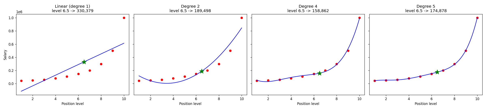
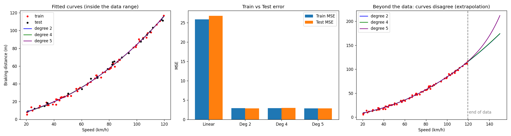
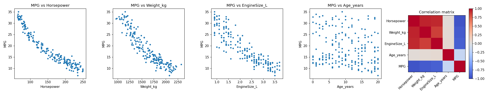
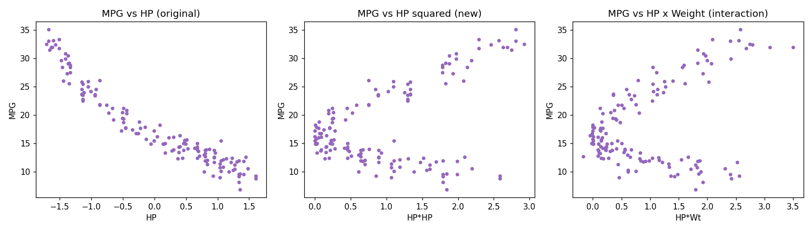
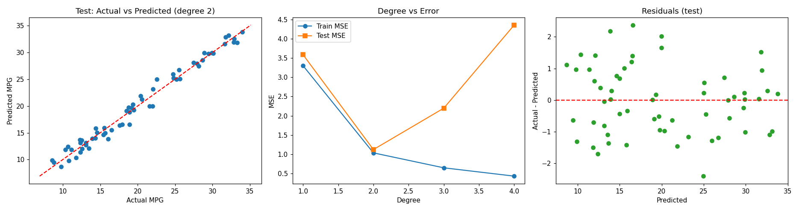

# Lab 05: Polynomial Regression From Scratch

This project demonstrates polynomial regression using NumPy, pandas, and Matplotlib. It does not use scikit-learn: polynomial features, least-squares fitting, evaluation metrics, train/test splitting, scaling, and feature selection are implemented directly in the Python scripts.

## Project structure

```text
lab05/
├── README.md                              # Project guide and results
├── LAB05_Tasks_and_Viva.md                # Lab questions and viva answers
├── lab05_task1_polynomial_regression.py  # Task 1: one-feature models
├── lab05_task2_multi_feature_polynomial.py# Task 2: multi-feature models
├── make_datasets.py                       # Regenerate the synthetic CSV files
├── Position_Salaries.csv                  # Task 1, Part A
├── Braking_Distance.csv                   # Task 1, Part B
├── Car_MPG.csv                            # Task 2
└── outputs/                               # Generated figures from both scripts
	├── task1_A_position_degrees.png
	├── task1_B_braking_degrees.png
	├── task2_explore.png
	├── task2_engineered_features.png
	└── task2_results.png
```

For quick grading, start with the two Python scripts, then open the five images in `outputs/`. The longer explanation and viva preparation are in `LAB05_Tasks_and_Viva.md`.

## Requirements

```bash
pip install numpy pandas matplotlib
```

Run both experiments from this folder:

```bash
python lab05_task1_polynomial_regression.py
python lab05_task2_multi_feature_polynomial.py
```

Each script prints evaluation results and saves its PNG plots in `outputs/`. Matplotlib windows may also open while the scripts run.

## What the experiments show

## Task 1: Single-feature polynomial regression

**Goal:** show how adding powers of one input helps a model fit a curved relationship, then compare generalisation on unseen data.

**Part A: Position salaries.** The script compares a straight line with degree 2, 4, and 5 polynomials using the ten salary points from the lab manual. The degree-4 model predicts approximately **158,862** at level 6.5. Degree 5 has a slightly better training fit, but with only ten rows it is a warning about memorisation rather than evidence of a better model.

**Part B: Braking distance.** The script uses a reproducible 70/30 train/test split. The test results are:

| Model | Train MSE | Test MSE | Test R² |
|---|---:|---:|---:|
| Linear | 25.839 | 26.789 | 0.974 |
| Degree 2 | 2.929 | **2.867** | **0.997** |
| Degree 4 | 2.913 | 3.000 | 0.997 |
| Degree 5 | 2.854 | 2.895 | 0.997 |

**Interpretation:** degree 2 is selected because it achieves the lowest test error with the simplest useful curve. The output image also shows that extrapolating beyond the observed speed range is risky because high-degree curves can diverge.

## Task 2: Multi-feature polynomial regression

**Goal:** predict MPG from horsepower, vehicle weight, engine size, and age while demonstrating scaling, interaction terms, feature selection, and overfitting.

The model standardises training features, creates polynomial terms and interactions, and evaluates degrees 1 through 4:

| Degree | Terms | Train MSE | Test MSE | Test R² |
|---:|---:|---:|---:|---:|
| 1 | 5 | 3.301 | 3.586 | 0.935 |
| 2 | 15 | 1.036 | **1.122** | **0.980** |
| 3 | 35 | 0.648 | 2.197 | 0.960 |
| 4 | 70 | 0.432 | 4.356 | 0.922 |

**Interpretation:** degree 2 is chosen using the simplest-within-5%-of-best test-error rule. The final model predicts **17.64 MPG** for a car with 150 HP, 1700 kg, a 2.2 L engine, and age 5 years. Training error keeps falling at higher degrees, but test error rises, which is the overfitting pattern. Horsepower is the strongest predictor, followed by weight and age.

## Output screenshots and explanations

The images below are generated by the scripts and stored in `outputs/`. They are ordered in the same sequence as the code so a reader can connect each figure to the corresponding experiment.

### Salary models: linear versus polynomial curves



The degree-4 curve follows the salary progression much more closely than the linear model. The green marker shows the prediction at level 6.5.

### Braking-distance model comparison



The left plot compares fitted curves, the middle plot compares training and test MSE, and the right plot shows why polynomial extrapolation outside the observed speed range is risky.

### Dataset exploration



The first four panels show MPG relationships with each input. The heat map highlights the strong negative relationships between MPG and horsepower, weight, and engine size.

### Engineered polynomial features



The plots show an original feature, a squared feature, and an interaction term created by the custom `poly_features()` function.

### Final MPG results



The actual-versus-predicted plot shows test performance, the middle plot shows the overfitting pattern as degree increases, and the residual plot checks the remaining prediction errors.

## Main conclusions

Polynomial terms allow a linear-in-the-coefficients model to represent curved relationships. Increasing the degree reduces training error, but it can increase test error by fitting noise. In both experiments, degree 2 provides the best balance between flexibility, accuracy, and interpretability.
